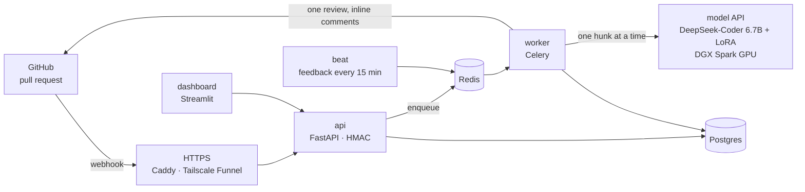

<div align="center">

# Smart PR Analyzer

**An AI code reviewer for GitHub pull requests, fine-tuned on real human reviews.**

[](https://github.com/ChandrashekarHL/smart-pr-analyzer/actions/workflows/ci.yml)


</div>

Open a pull request and the reviewer answers within seconds with inline
comments, placed on the exact diff lines a human reviewer would choose. Each
comment carries a severity, an issue type, an explanation and a suggested fix.

The model is DeepSeek-Coder 6.7B, fine-tuned with QLoRA on **12,483 human
review comments from 208 open-source repositories**. Every number below is
measured on **repositories the model never saw in training**.

```text
🔴 critical · SECURITY — The query is assembled from request input with an
f-string, so a crafted id can change the SQL that runs.

Suggestion: Use a parameterised query: cursor.execute("... WHERE id = %s", (req.id,))

prana · confidence 0.82
```
<sub>The format of one inline comment. Severity and issue type are hints for the reader, not merge gates.</sub>

---

## Highlights

- **Human-review data, cleaned with care.** Of 188,052 scraped comments, AI-bot
  reviews were removed by account, not by text (19%). Pull-request authors replying
  to reviewers were also removed (43% of the rest). Held-out rows that share code
  with the training set were removed too. → [data pipeline](docs/data-pipeline.md)
- **Honest evaluation.** Whole repositories are held out (`test_ood`). Each output
  field is scored with its own metric, beside the majority-class baseline.
  Everything has bootstrap confidence intervals, and every comparison is paired.
  → [evaluation](docs/evaluation.md)
- **Production backend.** A GitHub App verifies webhooks with HMAC, acknowledges
  them in ~150 ms and queues the review (Celery and Redis). It posts one review
  per PR, with retries, deduplication and a dashboard. → [deployment](backend/DEPLOY.md)
- **Every component is measured before it ships.** Retrieval (RAG) was built to the
  design document and evaluated twice. It did not help this model, so it stays off.

## Results

`test_ood`: 1,190 reviews from 234 held-out repositories, 95% bootstrap CIs.

| Metric | v1.0 | **v1.1 (current)** | Baseline |
|---|---|---|---|
| Valid structured output | 99.5% | **99.5%** | — |
| Severity macro-F1 | 0.270 | **0.352** | — |
| Severity accuracy | 50.6% | 47.0% [44.0, 49.9] | majority class 49.4% |
| Issue-type accuracy | 35.4% | 34.5% [31.9, 37.3] | majority class 28.0% |
| Line number exact (where the human gave one) | 0.7% | **14.7%** | — |
| Explanation BERTScore F1 | 0.854 | 0.856 | — |
| Review latency, one hunk (GB10, 4-bit) | 3.3 s | 3–5 s | 30 s budget per PR |

**How to read this.** v1.0 collapsed to the majority class: it labelled 93% of
findings `info` and never `critical`. v1.1 put the reasoning before the label and
added line numbers to the prompt, which fixed that collapse (macro-F1 0.27 → 0.35)
and made line references work. Most of the remaining disagreement with the human
is about *which* issue to raise, not mislabelling. The model's severity matches an
independent reading of its own explanation 82% of the time.
→ [model card](MODEL_CARD.md) · [training report](TRAINING_REPORT.md)

| Ablation | Result |
|---|---|
| **A**: fine-tuned vs base model | Fine-tuning helps: ROUGE-L +0.0093 [+0.0072, +0.0115], paired. The base model writes 162-word answers against 51 for humans |
| **B**: retrieved context vs none | Context hurts this model: line exact −8.8 points\* with code from the repository, −2.7\* with corpus memory |

\* 95% CI excludes zero.

## Architecture



1. **Data** (`prana.data`): scrape → bot and author-reply removal → splits by PR and
   by repository → 13-gram decontamination → teacher labelling → finalized schema.
2. **Training** (`prana.train`): QLoRA 4-bit NF4, r=16, α=32, all attention and MLP
   projections, completion-only loss, Unsloth. 3 epochs on one DGX Spark (GB10).
3. **Retrieval** (`prana.rag`): enclosing code, cross-file definitions, ChromaDB
   similar code, measured repo conventions, past reviews and git history, all
   behind one function that never raises. Off in serving (see ablation B).
4. **Serving** (`prana.serve`, `prana.api`): 4-bit inference, prompt-contract
   check, confidence from token probabilities. Reachable over Tailscale only.
5. **GitHub App** (`backend/`): webhook, queue, review pipeline, dashboard.

## Repository layout

```text
src/prana/            model side: data, training, evaluation, retrieval, serving
  data/               build, filters, licences, redaction, decontamination, labelling
  eval/               generation, per-field scoring, paired comparison, human eval
  rag/                retrieval contract, code context, embeddings, conventions
  prompts.py          the versioned train/serve prompt contract
  serve.py api.py     inference and the authenticated model API
backend/              the GitHub App: prana_app (FastAPI + Celery), dashboard, Docker
configs/              training configurations, one per run
scripts/              GPU jobs and evaluations run on the DGX Spark
tests/                model-side tests (backend tests live in backend/tests)
docs/                 pipeline, evaluation, requirements traceability
```

## Getting started

**Tests.** No GPU or network needed. CI runs both suites on every push.

```bash
pip install pytest rouge-score fastapi httpx
PYTHONPATH=src pytest                                   # model side

cd backend
pip install -r requirements.txt -r dashboard/requirements.txt pytest
PYTHONPATH=src:../src:tests pytest                      # backend + dashboard
```

**Train and evaluate.** These need a CUDA GPU. The project runs them on a DGX Spark.

```bash
python -m prana.data.build --out data/train_v2 --allow-any-license
python -m prana.data.decontaminate --data data/train_v2 --apply
python -m prana.train --config configs/deepseek_v11.yaml
python -m prana.eval.generate --model deepseek-ai/deepseek-coder-6.7b-instruct \
    --adapter runs/v1.1/adapter --data data/v1.1 --split test_ood --out runs/v1.1/eval
python -m prana.eval.structured --predictions runs/v1.1/eval/test_ood.predictions.jsonl
```

**Serve the model.**

```bash
python -m prana.api --adapter runs/v1.1/adapter          # binds the Tailscale address, port 8100
python -m prana.client health --url http://<host>:8100 --key-file api.key
```

**Deploy the GitHub App.** It runs on the Spark behind Tailscale Funnel, or on
any VM with Docker. Follow [`backend/DEPLOY.md`](backend/DEPLOY.md).

## Design decisions

| Decision | Why |
|---|---|
| Remove bot reviews by **account**, not text | Copilot and Codex write prose no regex can separate from a human's |
| Hold out **whole repositories** | Splitting by PR still left ~5% of test rows sharing code with training |
| **Teacher labels** that restate the human comment | GitHub has no severity or issue type; restating keeps the finding human. Teacher self-agreement κ 0.92 |
| **Versioned prompt contract** with a fingerprint | Train/serve prompt drift fails silently; here it fails loudly |
| **Explanation before severity** in the output | v1.0 picked the label before reasoning and collapsed to `info` |
| **Paired tests before switching anything on** | Retrieval looked like a sure win and measured as a loss |
| **Secrets as files**, non-root containers, HMAC | No key appears in env vars, `docker inspect`, logs or git |

## Documentation

| Document | Contents |
|---|---|
| [Model card](MODEL_CARD.md) | Intended use, full results, limitations |
| [Training report](TRAINING_REPORT.md) | Six runs, what failed, and what each failure changed |
| [Data pipeline](docs/data-pipeline.md) | Every filter and the reasoning behind it |
| [Evaluation](docs/evaluation.md) | Metrics, principles, ablations |
| [Deployment](backend/DEPLOY.md) | GitHub App registration, Spark or VM deployment, operations |
| [Requirements traceability](docs/requirements-traceability.md) | Every requirement of the design document, its status and evidence |

## Limitations

- Severity and issue type disagree with the human reference on more than half
  the rows. Use them as hints, never to block a merge.
- One hunk at a time, in five languages, with a 2,048-token window. Very long
  hunks are cut in the middle.
- Retrieval did not help the current model. A model trained with this context is
  the next experiment.
- The issue-detection and security-detection rates from the design document are
  not measured yet.

## About

A 6th-semester major project, B.E. Computer Science (AI & ML), VTU. The training
data is used internally and is not distributed with this repository.
